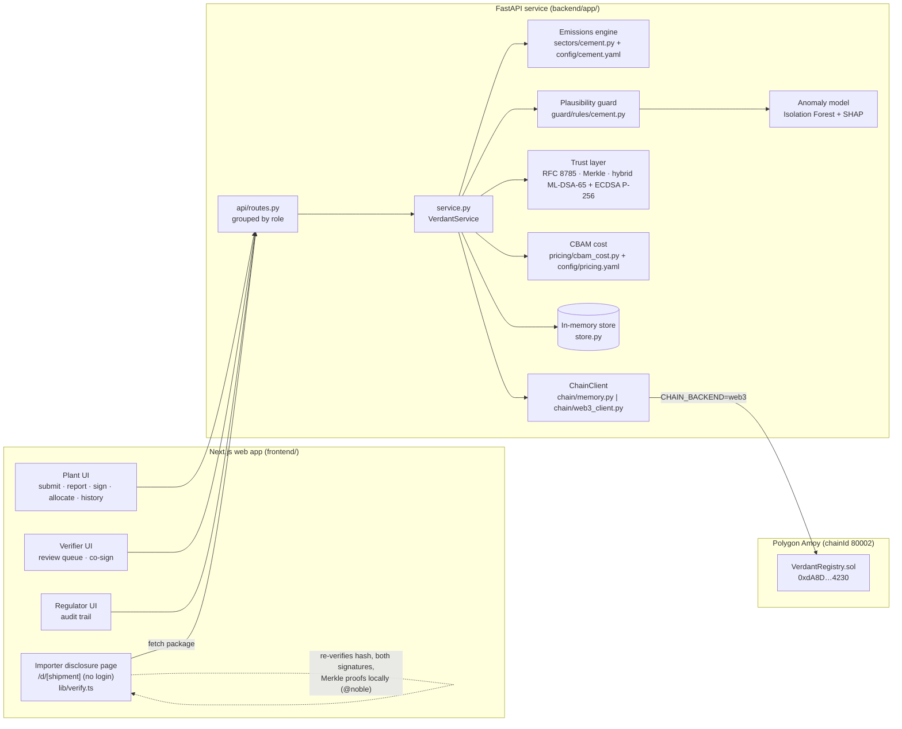
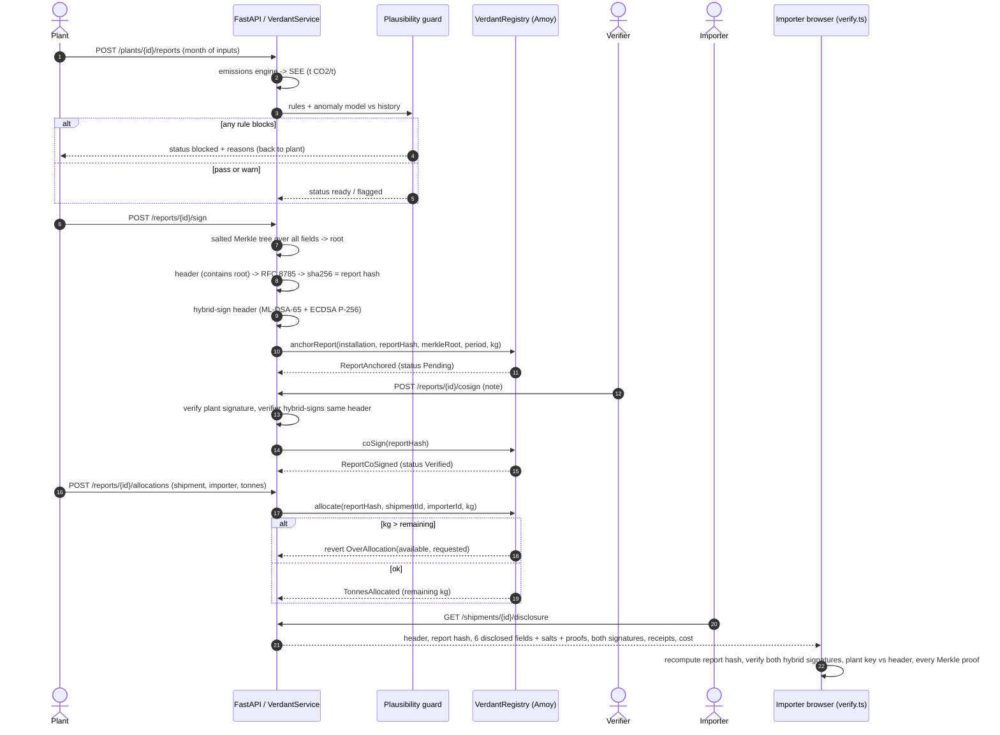

# Architecture and technical specification

VERDANT-X has four parts: a web app with one screen per role, a FastAPI service, a trust layer that signs and commits reports, and a smart contract on Polygon Amoy that stores fingerprints and enforces allocation limits. Private plant data never leaves the off-chain store.

## 1. Components

| Component | Code | Role |
|---|---|---|
| Plant UI | `frontend/app/(app)/plant/{submit,report,sign,allocate,history}` | Enter a month, see guard results, sign, allocate tonnes to shipments |
| Verifier UI | `frontend/app/(app)/verifier` | Review plant-signed reports and their flags, co-sign |
| Importer disclosure page | `frontend/app/(public)/d/[shipment]`, `…/cost` | Public link per shipment; verifies the package in the browser; cost comparison |
| Regulator UI | `frontend/app/(app)/regulator` | Live audit trail: chain events, reports, allocations, refused attempts |
| API | `backend/app/api/routes.py`, `main.py` | Thin HTTP layer over `VerdantService` |
| Service | `backend/app/service.py` | The whole flow, independent of the web layer |
| Emissions engine | `backend/app/sectors/` | CBAM method for cement (clinker as precursor) |
| Plausibility guard | `backend/app/guard/` | 7 rules + optional anomaly model per plant |
| Trust layer | `backend/app/trust/` | Canonical JSON, salted Merkle tree, hybrid signatures, demo keystore |
| Chain client | `backend/app/chain/` | Same interface for an offline in-memory chain and a web3 client |
| Contract | `contracts/contracts/VerdantRegistry.sol` | Fingerprints, status, allocation limits, events |
| Store | `backend/app/store.py` | Plants, reports, salts, allocations. In-memory for the demo |

## 2. End-to-end flow

## 3. Data model

### Signed report header

Built in `VerdantService.plant_sign`. This is the only object that is signed and hashed. It holds no private values.

| Field | Example | Meaning |
|---|---|---|
| `schema` | `verdant-x/report/v1` | Format version |
| `plant_id` | `TR-ANA-01` | Installation id |
| `period` | `2026-12` | Reporting month |
| `sector` | `cement` | Sector module |
| `merkle_root` | 64 hex | Root over all report fields (public and private) |
| `product_t` | float | Cement produced, t |
| `plant_key_fingerprint` | 64 hex | sha256 over the plant's per-scheme key fingerprints |

- **Report hash** = `sha256(RFC8785(header))`, hex.
- **Signed message** = `"VERDANT-X/report-signature/v1\x00" ‖ RFC8785(header)`. Plant and verifier sign the same message.
- **Hybrid signature** = `{signer, message_sha256, components[{alg, public_key, signature, key_fingerprint}]}`.

### Merkle leaves (`trust/merkle.py`)

| Item | Definition |
|---|---|
| Leaf | `sha256(0x00 ‖ salt ‖ RFC8785({"k": field, "v": value}))` |
| Salt | 32 random bytes per leaf (`secrets.token_bytes(32)`) |
| Node | `sha256(0x01 ‖ left ‖ right)` |
| Odd node | Carried up unchanged |
| Leaf order | Fields sorted by name |
| Proof | List of `{sibling, side}` from leaf to root |

Leaves for a cement report (`VerdantService._leaves`):

- **Public:** `plant_id`, `period`, `sector`, `cn_code`, `product_t`, `see_total`, `see_direct`, `see_indirect`.
- **Private:** every input as `input.<name>` (fuel mix, clinker chemistry, electricity, volumes, carbon price evidence), every calculation component as `calc.<name>`, and `guard.status`.
- **Disclosed to an importer by default:** `see_total`, `see_direct`, `see_indirect`, `cn_code`, `period`, `plant_id`. The importer also sees how many private leaves exist per group, never their values.

### Report status (off-chain)

`blocked` → back to plant · `flagged` (warnings, verifier must review) · `ready` · `plant_signed` (anchored, Pending on-chain) · `verified` (co-signed, allocatable).

## 4. Smart contract: `VerdantRegistry.sol`

Solidity 0.8.24, optimizer on (200 runs). Deployed on Polygon Amoy at [`0xdA8D576790524F96Ee6DFC5365C8aF6Be33d4230`](https://amoy.polygonscan.com/address/0xdA8D576790524F96Ee6DFC5365C8aF6Be33d4230#code), source verified.

**State.** `owner`; `installations[id] → {operator, operatorKeyFingerprint, active}`; `verifiers[address] → {keyFingerprint, active}`; `reports[reportHash] → {installationId, merkleRoot, operatorKeyFingerprint, verifierKeyFingerprint, verifier, verifiedKg, allocatedKg, status, period}`; `reportForPeriod[installation][keccak(period)] → reportHash`; `shipmentUsed[shipmentId]`.

| Function | Caller | Effect | Reverts with |
|---|---|---|---|
| `registerInstallation(id, operator, keyFp)` | owner | Registers (or overwrites) an installation | `NotOwner` |
| `setVerifier(addr, keyFp, active)` | owner | Allow-lists or revokes a verifier | `NotOwner` |
| `anchorReport(id, reportHash, merkleRoot, period, verifiedKg)` | installation operator | Stores report as Pending | `UnknownInstallation`, `NotOperator`, `ReportExists`, `ZeroAmount`, `PeriodAlreadyReported(existing)` |
| `coSign(reportHash)` | active verifier | Pending → Verified, records verifier and key fingerprint | `NotVerifier`, `UnknownReport`, `NotPending`, `VerifierIsOperator` |
| `allocate(reportHash, shipmentId, importerId, kg)` | installation operator | Adds `kg` to `allocatedKg`, marks shipment used | `UnknownReport`, `NotOperator`, `NotVerified`, `ZeroAmount`, `ShipmentAlreadyAllocated`, `OverAllocation(available, requested)` |
| `remainingKg(reportHash)` | anyone (view) | `verifiedKg − allocatedKg` | – |

**Events:** `InstallationRegistered`, `VerifierSet`, `ReportAnchored`, `ReportCoSigned`, `TonnesAllocated` (includes remaining kg).

**Units and ids.** Tonnes are stored as integer kg (`round(t × 1000)`). In `web3_client.py`, 64-hex values (hashes, roots, fingerprints) pass through as `bytes32`; other ids are `keccak256(text)`, optionally prefixed by `CHAIN_NAMESPACE`.

**Gas** (measured with `REPORT_GAS=true npx hardhat test`, Hardhat network, average per call):

| Call | Gas |
|---|---|
| `anchorReport` | 196,496 |
| `coSign` | 81,924 |
| `allocate` | 76,001 (62,323–79,423) |
| `registerInstallation` | 93,349 |
| `setVerifier` | 67,040 (29,028–70,852) |
| Deployment | 946,189 |

## 5. API endpoints (`/api` prefix)

| Role | Method and path | Purpose |
|---|---|---|
| Shared | `GET /health` | Liveness and chain backend |
| Shared | `GET /info` | Chain, contract address, verifier fingerprint, live period, demo importers |
| Shared | `GET /plants` · `GET /plants/{id}/reports` · `GET /reports/{id}` | Read plants and reports (salts never returned) |
| Plant | `POST /plants/{id}/preview` | Calculate only, for live form feedback |
| Plant | `POST /plants/{id}/reports` | Submit a month: calculate + guard |
| Plant | `POST /reports/{id}/sign` | Merkle commit, hybrid sign, `anchorReport` |
| Plant | `POST /reports/{id}/allocations` | `allocate` tonnes to a shipment |
| Verifier | `GET /verifier/queue` | Plant-signed reports awaiting review |
| Verifier | `POST /reports/{id}/cosign` | Check plant signature, hybrid co-sign, `coSign` |
| Importer | `GET /shipments/{id}/disclosure?year=` | Disclosure package |
| Importer | `POST /disclosure/verify` | Server-side re-check of a package (the browser does its own) |
| Importer | `GET /cost` · `GET /cost/schedule` | CBAM cost, default vs verified, one year or 2026–2034 |
| Regulator | `GET /audit` | Chain events, anchored and blocked reports, allocations, refused attempts (guard blocks and contract reverts) and headline stats |
| Demo | `GET /demo/scenarios` · `GET /demo/scenarios/{plant}?kind=` · `POST /demo/reset` | Prefilled honest or fraud months; reseed |

Errors return `{code, message, detail}`. Contract reverts become HTTP 409 with `code = "chain:<ErrorName>"` and decoded arguments (for example `available_kg`, `requested_kg`).

## 6. Cryptographic parameters

| Item | Value | Library |
|---|---|---|
| Post-quantum signature | ML-DSA-65 (FIPS 204). Public key 1,952 B, signature 3,309 B | liboqs 0.16 / liboqs-python (backend), `@noble/post-quantum` 0.7.1 (browser) |
| Classical signature | ECDSA P-256 / SHA-256, compressed public key, DER signature | `cryptography` (backend), `@noble/curves` 2.4.0 (browser) |
| Hybrid rule | Valid only if both required schemes are present and every component verifies | `trust/signatures/hybrid.py`, `lib/verify.ts` |
| Domain separation | `VERDANT-X/report-signature/v1\x00` prefix | both |
| Canonicalisation | RFC 8785 (JCS) | `rfc8785` (backend), `canonicalize` (browser) |
| Hash | SHA-256 (report hash, Merkle, key fingerprints); keccak256 only for on-chain ids and `period` keys | |
| Key fingerprint | per scheme `sha256(pk)`; hybrid `sha256(fp_1 ‖ fp_2)` | |
| Scheme selection | `SIGNATURE_SCHEMES` env (default `ML-DSA-65,ECDSA-P256-SHA256`) | |

## 7. Config-driven design

- **No factors in code.** `config/cement.yaml` holds calcination factors, fuel NCV/EF/biomass shares, grid factor, EU default values and mark-ups, CBAM benchmarks and every guard threshold, each with a `source`. Unchecked entries carry `verify: true`.
- **Pricing.** `config/pricing.yaml` holds the certificate price (€77.65, mean of 2026 Q1–Q3) and the free-allocation factor by year (0.975 in 2026 to 0 in 2034).
- **Swappable backends.** `CHAIN_BACKEND=memory|web3`, `CHAIN_NETWORK=amoy|sepolia|localhost`, `SIGNATURE_SCHEMES`, `KEY_DIR`, `CHAIN_NAMESPACE`, `GAS_TIP_GWEI`.
- **In-memory chain.** `chain/memory.py` mirrors the contract's report, period, verification, shipment and over-allocation rules for tests and offline demos.

## 8. Adding a sector

1. Implement the `Sector` protocol (`sectors/base.py`): `name`, `inputs_model` (pydantic), `calculate(inputs) → EmissionsResult`, and a `cfg` dict. Put it in `sectors/<sector>.py` and register it in `sectors/__init__.py`.
2. Add `config/<sector>.yaml` with factors, defaults, benchmarks, product CN code and `guard` thresholds.
3. Add `guard/rules/<sector>.py` with one class per rule (`id`, `title`, `check(x, result, ctx) → Flag`), register the list in `guard/__init__.py` `RULE_SETS`, and add a feature function in `guard/anomaly.py` `FEATURES`.
4. Review `DISCLOSED_FIELDS` and the private-group labels in `service.py`. They currently name cement fields.

The trust layer, contract, chain clients and API do not change.
